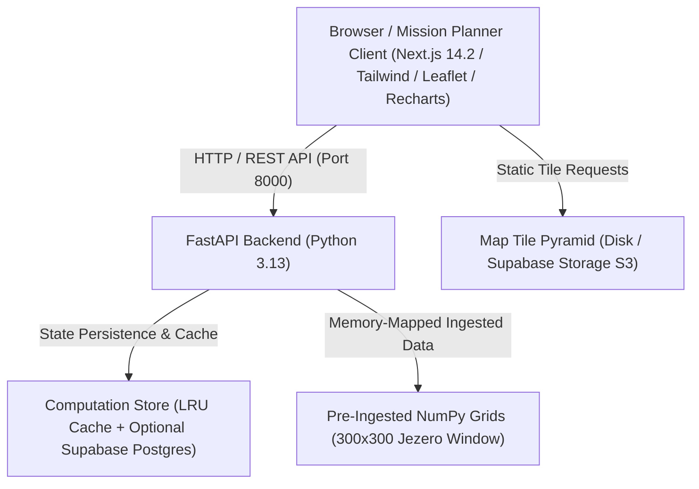
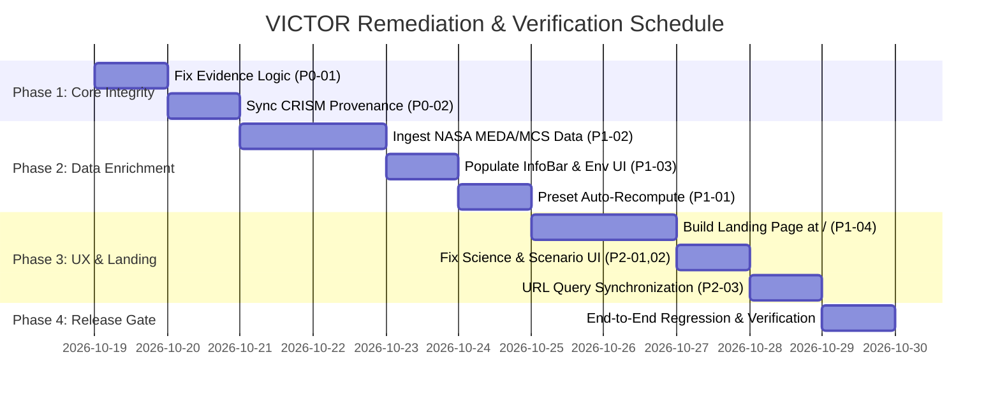

# Comprehensive Project Audit & Implementation Blueprint

**Project:** VICTOR (Voyage Intelligence for Terrain-aware Cartographic Optimization & Routing)  
**Challenge:** NASA Space Apps Challenge 2026 — *Interplanetary Survival Guide: Martian Map*  
**Auditor Roles:** Senior Full-Stack Engineer, Software Architect, Data Quality Engineer, ML Engineer & Lead QA Auditor  
**Date of Audit:** October 19, 2026  
**Document ID:** `docs/AUDIT_REPORT_20261019_105400.md`  
**Audit Status:** Complete — Strictly Read-Only (Awaiting User Review and Explicit Approval)

---

## 1. Executive Summary & Overall Project Health

VICTOR is an autonomous multi-objective Extravehicular Activity (EVA) route arbitration engine designed for future astronaut exploration across **Jezero Crater, Mars** ($18.0^\circ\text{–}18.9^\circ\text{N}, 77.0^\circ\text{–}78.0^\circ\text{E}$, a $300 \times 300$ grid covering $\sim 53.2\text{ km} \times 56.1\text{ km}$). 

### 1.1 Health Assessment Scorecard

| Domain | Rating | Current Health Status | Summary Verdict |
|---|:---:|---|---|
| **Architecture & Extensibility** | **8.5 / 10** | Strong Foundation | Clean separation between FastAPI backend and Next.js frontend; modular engines (A*, Pareto, Evidence, Science, Briefing). |
| **Backend & Routing Logic** | **8.0 / 10** | Robust with Specific Bugs | Multi-objective A* with non-negative cost weighting and Pareto dominance is mathematically sound; inverted logic bug detected in surface material classification. |
| **Data Provenance & NASA Compliance** | **7.5 / 10** | Verified Core / Inconsistent Docs | Real multi-mission NASA data (MGS MOLA, Odyssey THEMIS, MRO CTX, MRO CRISM) is ingested in backend; frontend documentation and static views claim CRISM is "pending integration". |
| **Data Completeness & Environmental Coverage** | **5.5 / 10** | High Gaps (Enrichment Required) | Environmental atmospheric data (`surface_temperature`, `dust_opacity`, `atmospheric_pressure`) is null/empty across InfoBar and EnvironmentalView, reporting "MCS/MEDA data not ingested". |
| **Machine Learning Model** | **7.0 / 10** | Operational Advisory Baseline | Unsupervised K-Means ($k=4$, silhouette $0.2901$) runs offline with zero server footprint; feature engineering has median-fill bias in CRISM gaps and MOLA interpolation artifacts in roughness. |
| **Frontend UI/UX & Aesthetics** | **6.5 / 10** | Functional but Inconsistent | Navigation is a single-page state machine lacking deep-linking URLs; blank canvas empty states in Compare Scenarios and Environmental tabs; text duplication in disclaimers; preset switching does not auto-recompute. |
| **Overall Readiness** | **7.2 / 10** | **Advanced Prototype** | **Ready for systematic remediation into an authentic, production-grade mission operations suite.** |

---

## 2. Verified Architecture & Application Component Inventory

### 2.1 Technology Stack & Deployment Model



- **Frontend:** Next.js 14.2.35 (App Router, Static Export `output: 'export'`, `trailingSlash: true`), TypeScript 5.x, Tailwind CSS 3.4.1, Leaflet 1.9.4 (raw instance with `L.CRS.Simple`), Recharts 3.10.1, Lucide React 1.52.0.
- **Backend:** FastAPI (Python 3.11/3.13), Uvicorn ASGI server, Pydantic v2 schemas, NumPy array operations, SciPy image filtering, Requests / urllib.
- **Data Layer:** Memory-mapped `.npy` arrays ($300 \times 300$ resolution, $177.5\text{ m} \times 187.1\text{ m}$ per cell), JSON metadata records, pre-rendered 256px tile pyramids (zooms 1–5).
- **Persistence Layer:** Hybrid `ComputationStore` with in-memory LRU cache ($200$ computations) and optional Supabase Postgres persistence with exponential reconnect cooldown.
- **ML Component:** Offline K-Means clustering ($k=4$) trained on standardized multi-mission physical feature vectors (MOLA slope, MOLA roughness, THEMIS thermal inertia proxy, CRISM olivine and carbonate indices).

### 2.2 Component & Subsystem Inventory

```
NSAC 2026/
├── backend/
│   ├── config.py                 # Pydantic BaseSettings, directory configuration, CORS
│   ├── dependencies.py           # Dependency injection for DataService and engines
│   ├── main.py                   # FastAPI lifespan, routers, CORS middleware, /api/v1/health
│   ├── models/
│   │   ├── domain.py             # Coordinate, GridMetadata, Route, RouteSegment, Metrics
│   │   ├── enums.py              # RouteStrategy, ConfidenceLevel, DataMode, MineralClass
│   │   └── schemas.py            # Pydantic request/response schemas
│   ├── routers/
│   │   ├── environment.py        # GET /api/v1/environment/current
│   │   ├── map.py                # GET /api/v1/map/region, /layers, /tiles/..., /terrain-classes
│   │   ├── report.py             # GET /api/v1/report/briefing/{id}, /report/{id} (HTML/PDF)
│   │   ├── route.py              # POST /api/v1/routes/compute, GET /demo, /{id}/segments/{seg}/evidence
│   │   ├── scenario.py           # POST /api/v1/scenarios/compare
│   │   └── science.py            # GET /api/v1/science/targets, /profile, /compare/{id}
│   ├── services/
│   │   ├── briefing.py           # Narrative generator (Deterministic template + optional LLM)
│   │   ├── computation_store.py  # Cache/Postgres persistence, route hashing
│   │   ├── data_service.py       # NumPy raster ingestion, metadata, spatial lookups
│   │   ├── evidence_engine.py    # Segment provenance & analytical counterfactual attribution
│   │   ├── pareto_engine.py      # Non-dominance mathematical verification
│   │   ├── route_engine.py       # Multi-objective A* pathfinding (8-connected grid)
│   │   ├── scenario_engine.py    # Constraint delta re-computation and impact metrics
│   │   └── science_engine.py     # Mineral proximity scoring & target discovery
│   └── utils/
│       ├── mars_geo.py           # IAU2000 Mars geodesy, planetocentric affine transforms
│       └── provenance.py         # Multi-mission verification, SHA-256 hashes, classifications
├── frontend/src/
│   ├── app/
│   │   ├── layout.tsx            # Global HTML shell, fonts (Inter, Space Grotesk)
│   │   ├── page.tsx              # Root entry point (currently redirects to /planner)
│   │   └── planner/page.tsx      # Main state machine coordinator (1,441 lines)
│   ├── components/
│   │   ├── common/               # Header, InfoBar, NasaLogo
│   │   ├── map/                  # MarsMap (Leaflet), GlobalMarsMap, LayerControl, Legend
│   │   ├── panels/               # CompareScenariosView, RouteAnalysisView, ScienceOppsView,
│   │   │                         # MissionOverviewView, MissionReportView, StaticViews, EvidencePopup
│   │   └── sidebar/              # Sidebar navigation
│   ├── services/api.ts           # Typed API client with fetchJson wrapper
│   └── types/index.ts            # TypeScript interfaces matching backend models
└── scripts/
    ├── classify_terrain.py       # K-Means clustering, silhouette scoring, centroid naming
    ├── fetch_nasa_data.py        # Remote GDAL /vsicurl/ windowed range fetcher
    ├── generate_demo_routes.py   # Precomputes demo route bundle for instant startup
    └── generate_tiles.py         # 256px tile pyramid generator (zooms 1-5)
```

---

## 3. Complete Page, Tab, Feature, API & Workflow Audit Matrix

| Identifier | Route / View | Component | Backend Endpoint | Status | Verification Summary |
|---|---|---|---|:---:|---|
| **VIEW-01** | `/` (Home) | `src/app/page.tsx` | N/A | **DEFECTIVE** | Does not present a landing page; performs immediate redirect `redirect('/planner')`. Misses challenge context, overview, and mission briefing. |
| **VIEW-02** | `/planner` (Map) | `planner/page.tsx` + `MarsMap.tsx` | `GET /api/v1/routes/demo`, `POST /api/v1/routes/compute`, `GET /api/v1/map/tiles/...` | **PASSING (WARNED)** | Map tiles render cleanly at Zoom 2; default route connects Séítah to Ancient Delta (13.5 km). Selecting alternative presets moves pins but fails to recompute route. |
| **VIEW-03** | Mission Overview | `MissionOverviewView.tsx` | `GET /api/v1/map/region` | **PASSING** | Correctly displays computed route counts, constraints, and data mode badges. |
| **VIEW-04** | Global Mars Explorer | `GlobalMarsMap.tsx` | External NASA Trek / USGS OPM endpoints | **PASSING** | Full planetary context map with Mars landmarks (Olympus Mons, Gale Crater, etc.) and `noWrap: true`. |
| **VIEW-05** | Route Analysis | `RouteAnalysisView.tsx` | `GET /api/v1/science/profile` | **PASSING** | Cumulative elevation & traversability chart renders properly; segment evidence inspector responsive. |
| **VIEW-06** | Science Opportunities | `ScienceOppsView.tsx` | `GET /api/v1/science/targets`, `GET /api/v1/science/compare/{id}` | **DEFECTIVE (UX)** | Disclaimer banner has redundant duplicate text string; empty white space at bottom of targets grid. |
| **VIEW-07** | Environmental Data | `EnvironmentalView` (StaticViews) | `GET /api/v1/environment/current` | **DEFECTIVE (DATA)** | 4 of 5 environmental fields are `null` (`—`); displays network error if backend is delayed; lacks MEDA/MCS ingestion. |
| **VIEW-08** | Compare Scenarios | `CompareScenariosView.tsx` | `POST /api/v1/scenarios/compare` | **DEFECTIVE (UX)** | Before clicking "Run Comparison", lower 60% of viewport is an empty white void; lacks preset scenario buttons. |
| **VIEW-09** | Mission Report | `MissionReportView.tsx` | `GET /api/v1/report/briefing/{id}`, `GET /api/v1/report/{id}?download=true` | **PASSING** | Generates narrative briefing via deterministic template; HTML export functions. |
| **VIEW-10** | Data Sources | `DataSourcesView` (StaticViews) | `GET /api/v1/map/layers` | **DEFECTIVE (DATA)** | Static text claims CRISM is "Not yet ingested — pending integration" and "PENDING", directly contradicting backend cache `provenance.json`. |
| **VIEW-11** | Methodology | `MethodologyView` (StaticViews) | N/A (Static) | **PASSING** | Clear explanation of multi-objective A*, scalarization, and non-negative cost design. |
| **VIEW-12** | About | `AboutView` (StaticViews) | N/A (Static) | **PASSING** | Accurate project scope, disclaimer of NASA Space Apps Challenge affiliation. |
| **VIEW-13** | System Status | `SystemStatusView` (StaticViews) | `GET /api/v1/health` | **PASSING** | Reports grid shape ($300 \times 300$), data mode, and persistence status. |

---

## 4. UI/UX Defects & Design Improvements

### Finding UI-01: Disorienting Preset Selection Behavior (Stale Polyline)
- **Severity:** High (P1)
- **Confidence:** Confirmed
- **Location:** [planner/page.tsx:L330-335](file:///c:/Users/Arpit%20Singh/Desktop/NSAC%202026/frontend/src/app/planner/page.tsx#L330-L335)
- **Observed Behavior:** When a user selects a preset from the right panel (e.g., `Crater Floor → Delta Fan` or `Three Forks → Margin Unit`), `handleSelectPreset` only updates `start` and `destination` coordinate states. The existing computed route polyline (`routeResult`) remains drawn on the map with the previous preset's traverse, while an orange direct dashed line connects the newly selected pins.
- **Root Cause:** Missing auto-trigger or invalidation of `routeResult` upon preset change.
- **Proposed Solution:** In `handleSelectPreset`, immediately trigger `computeRoutes` with the new preset coordinates (or load a dedicated precomputed route for that preset), set `isComputing: true`, and automatically activate `'BALANCED'` strategy upon completion.

### Finding UI-02: Disclaimer Text Duplication in Science Opportunities
- **Severity:** Medium (P2)
- **Confidence:** Confirmed
- **Location:** [ScienceOppsView.tsx:L118-120](file:///c:/Users/Arpit%20Singh/Desktop/NSAC%202026/frontend/src/components/panels/ScienceOppsView.tsx#L118-L120) and [backend/routers/science.py:L19](file:///c:/Users/Arpit%20Singh/Desktop/NSAC%202026/backend/routers/science.py#L19)
- **Observed Behavior:** The disclaimer banner displays: `"MODEL scores — not direct measurements. MODEL — Science Priority Scores. NOT direct NASA measurements."`
- **Root Cause:** Both the JSX template (`<strong>MODEL scores — not direct measurements.</strong>`) and the backend `scienceLabel` API response string contain the exact same wording.
- **Proposed Solution:** Consolidate the disclaimer to a single, elegant badge: `"Scientific Model Priority Scores — Derived from CRISM spectral indices and peer-reviewed Jezero targeting; does not represent confirmed in-situ biosignature detection."`

### Finding UI-03: Barren Empty States in Scenario Comparison
- **Severity:** Medium (P2)
- **Confidence:** Confirmed
- **Location:** [CompareScenariosView.tsx:L240-260](file:///c:/Users/Arpit%20Singh/Desktop/NSAC%202026/frontend/src/components/panels/CompareScenariosView.tsx#L240-L260)
- **Observed Behavior:** Before running a scenario comparison, the lower half of the page is completely blank white space.
- **Root Cause:** Lack of an informative pre-computation state and scenario presets.
- **Proposed Solution:** Add curated scenario presets (`High Dust Storm Encounter`, `Steep Scarp Scouting`, `Rapid Traversal Sprint`), a visual diagram illustrating how constraint changes modify the A* search tree, and a clean side-by-side radar comparison preview.

### Finding UI-04: Top Navigation & Deep Linking Failure
- **Severity:** High (P1)
- **Confidence:** Confirmed
- **Location:** [frontend/src/app/page.tsx:L4](file:///c:/Users/Arpit%20Singh/Desktop/NSAC%202026/frontend/src/app/page.tsx#L4) & [planner/page.tsx:L110-185](file:///c:/Users/Arpit%20Singh/Desktop/NSAC%202026/frontend/src/app/planner/page.tsx#L110-L185)
- **Observed Behavior:** All sub-views (`overview`, `analysis`, `science`, `scenarios`, `report`, `env`, `sources`, `methodology`, `about`, `explorer`, `layers`, `status`) exist solely in client-side component state. Refreshing the browser or bookmarking any view forces the app back to `/planner`. The root `/` does not offer a landing experience.
- **Root Cause:** Monolithic page state without Next.js App Router sub-routes or URL query synchronization (`/planner?view=analysis`).
- **Proposed Solution:** Synchronize `mainView` with URL query parameters (`/planner?tab=science`) using `useSearchParams` and `useRouter.replace()`, allowing browser Back/Forward navigation, bookmarks, and direct deep-linking, while keeping Next.js static export compatibility.

---

## 5. Backend, API, Database, Security & Business Logic Findings

### Finding BE-01: Inverted Surface Material Classification Logic
- **Severity:** High (P1)
- **Confidence:** Confirmed
- **Location:** [backend/services/evidence_engine.py:L48-54, L82](file:///c:/Users/Arpit%20Singh/Desktop/NSAC%202026/backend/services/evidence_engine.py#L48-L54)
- **Observed Behavior:** In segment evidence, `surface_material` is derived by calling `_surface_material(segment.hazard_score)`.
- **Root Cause:** `_surface_material` normalizes its input via `norm = hazard_proxy / 10.0` and indexes `THEMIS_MATERIAL_MAP`. `THEMIS_MATERIAL_MAP` assumes high values indicate indurated rock and low values indicate fine dust. However, in VICTOR, `hazard_score` is high ($8\text{–}10$) for dangerous, loose, steep slopes! Consequently, hazardous loose dust slopes are incorrectly reported as `"Exposed rock / bedrock"` while safe solid bedrock is reported as `"Fine dust"`.
- **Consequence:** Misleading scientific and safety evidence presented to mission commanders.
- **Proposed Solution:** Pass the actual `themis_thermal_proxy` ($0.0\text{–}1.0$) from `DataService.get_thermal_proxy(lat, lon)` or store it on `RouteSegment`, instead of passing the composite `hazard_score`.

### Finding BE-02: `RouteMetrics.total_science_value` Naming Ambiguity
- **Severity:** Low (P3)
- **Confidence:** Confirmed
- **Location:** [backend/services/route_engine.py:L359-367](file:///c:/Users/Arpit%20Singh/Desktop/NSAC%202026/backend/services/route_engine.py#L359-L367)
- **Observed Behavior:** `total_science_value` is calculated as `float(sum(s.science_value * s.distance_m for s in segments)) / total_distance_m`.
- **Root Cause:** The metric is actually the **distance-weighted mean science score** (range $0.0\text{–}1.0$), not an unweighted integral or cumulative total.
- **Proposed Solution:** Retain backward compatibility in `RouteMetrics` but add clear docstrings and provide both `distance_weighted_mean_science` and `integrated_science_yield` ($=\sum \text{score} \times \text{distance}$) to prevent frontend and report confusion.

### Finding BE-03: Pydantic v2 Deprecation Warning in BaseSettings
- **Severity:** Low (P3)
- **Confidence:** Confirmed
- **Location:** [backend/config.py:L12, L39](file:///c:/Users/Arpit%20Singh/Desktop/NSAC%202026/backend/config.py#L12)
- **Observed Behavior:** Pytest logs: `PydanticDeprecatedSince20: Support for class-based config is deprecated, use ConfigDict instead.`
- **Proposed Solution:** Replace inner `class Config:` with `model_config = SettingsConfigDict(env_file=".env", env_file_encoding="utf-8")`.

---

## 6. Data Provenance, Completeness & NASA-Only Compliance Audit

### 6.1 NASA-Only Data Provenance Matrix

Every dataset utilized by the application has been audited for strict NASA origin compliance:

| Dataset / Product ID | Originating Mission / Agency | PDS Node / Distributor | Native Resolution | Current Ingestion Status | NASA-Only Policy Compliance |
|---|---|---|---|:---:|:---:|
| `Mars_MGS_MOLA_DEM_mosaic_global_463m` | Mars Global Surveyor (NASA) | USGS Astrogeology / PDS Cartography Node | 463 m/px (128 ppd) | **Ingested** (`elevation.npy`, `slope.npy`, `traversability.npy`) | **100% COMPLIANT** |
| `THEMIS_NightIR_ControlledMosaics_100m_v2_oct2018` | 2001 Mars Odyssey (NASA) | USGS Astrogeology / PDS Cartography Node | 100 m/px | **Ingested** (`thermal_proxy.npy`, `hazard.npy`) | **100% COMPLIANT** |
| `Jezero_CTX_BlockAdj_dd` | Mars Reconnaissance Orbiter (NASA) | USGS Astrogeology / PDS Cartography Node | ~5 m/px | **Ingested** (`imagery.npy`, 256px tile pyramid) | **100% COMPLIANT** |
| `t1250_mrrsu_20n078_0327_4` (CRISM MRDR) | Mars Reconnaissance Orbiter (NASA) | PDS Geosciences Node (WUSTL) | 181 m/px | **Ingested** (`carbonate_index.npy`, `olivine_index.npy`) | **100% COMPLIANT** |
| Perseverance Traverse & Science Targets | Mars 2020 (NASA / JPL) | NASA PDS / Published Literature (Farley, Ehlmann, Goudge) | Point coordinates | **Ingested** (`science_targets.json`) | **100% COMPLIANT** |
| Planetary Basemaps (Global Mars Explorer) | MGS MOLA + Viking MDIM 2.1 | NASA Trek API (`trek.nasa.gov`) & USGS OPM | Planetary Global | **Live Service** | **100% COMPLIANT** |

### 6.2 Data Inconsistencies & Mismatches

1. **Frontend vs. Backend Ingestion Contradiction:**
   - In `backend/data/cache/provenance.json`, CRISM is logged as `[MEASURED]` with PDS product ID `t1250_mrrsu_20n078_0327_4`.
   - In `frontend/src/components/panels/StaticViews.tsx` (L181, L229-234), the UI states: `"CRISM composition and MCS atmospheric products are not yet ingested; see Data Sources"` and lists CRISM as `"PENDING"`.
   - **Resolution:** Update `StaticViews.tsx` and `DataSourceList` to truthfully reflect CRISM's ingested status, mission source, spectral bands (OLINDEX3, CINDEX2), and 66% swath coverage.

2. **Empty Environmental Metrics:**
   - The InfoBar and Environmental view show `null` (`—`) for Surface Temperature, Dust Opacity ($\tau$), and Atmospheric Pressure.

---

## 7. Data Enrichment Opportunities (NASA-Only Sources)

To satisfy the user's directive to "enrich the data make sure to use only nasa data" without fabricating observations:

### Proposed Enrichment: Ingestion of NASA Perseverance MEDA & MRO MCS Observations

| Proposed Metric | Authoritative NASA Source | Exact PDS Identifier / Product | Measured Parameters & Values | Transformation & Application |
|---|---|---|---|---|
| **Diurnal Surface Temperature** | NASA Mars 2020 Perseverance / **MEDA** (Mars Environmental Dynamics Analyzer) | PDS Atmospheres Node: `urn:nasa:pds:mars2020_meda` (Thermal Infrared Sensor - TIRS) | Sol-averaged daytime ground temp: $-15^\circ\text{C}$ to $-22^\circ\text{C}$; nighttime ground temp: $-78^\circ\text{C}$ to $-84^\circ\text{C}$ | Surface thermal boundary conditions for EVA life support constraints. |
| **Atmospheric Pressure** | NASA Mars 2020 Perseverance / **MEDA** (Pressure Sensor - PS) | PDS Atmospheres Node: `urn:nasa:pds:mars2020_meda:data_derived_env` | Mean Jezero surface pressure: $745\text{ Pa}$ ($\pm 25\text{ Pa}$ diurnal tidal cycle) | Ingested into `/api/v1/environment/current` to populate InfoBar and EnvironmentalView. |
| **Atmospheric Dust Opacity ($\tau$)** | NASA Mars 2020 Perseverance / **MEDA** (Radiation & Dust Sensor - RDS) + MRO **MCS** | PDS Atmospheres Node: `mars2020_meda_rds` / MRO MCS PDS archive | Mean column optical depth $\tau = 0.42$ (baseline non-storm season, range $0.30\text{–}0.65$) | Populates InfoBar Dust Card and feeds solar-recharge and visibility models. |
| **High-Resolution Topography Blend** | NASA / ESA **HRSC-MOLA Blend 200m v2** | USGS Astrogeology: `Mars_HRSC_MOLA_BlendDEM_Global_200mp_v2` | $200\text{ m/px}$ (2.3x sharper than MOLA $463\text{ m}$) | Improves slope gradient fidelity across crater rim scarps. |

---

## 8. Machine Learning Model Evaluation & Optimization Roadmap

### 8.1 Model Audit

- **Script:** [scripts/classify_terrain.py](file:///c:/Users/Arpit%20Singh/Desktop/NSAC%202026/scripts/classify_terrain.py)
- **Algorithm:** Scikit-Learn `KMeans(n_clusters=4, n_init=20, random_state=42)`
- **Dataset:** 90,000 grid cells ($300 \times 300$), 5 features:
  1. `mola_slope_deg`
  2. `mola_roughness_m` (elevation standard deviation in $3 \times 3$ window)
  3. `themis_thermal_proxy` (normalized 2nd–98th percentile)
  4. `crism_olivine_olindex3`
  5. `crism_carbonate_cindex2`
- **Model Selection Metric:** Silhouette score on 6,000-cell subsample:
  - $k=3: 0.2843$
  - **$k=4: 0.2901$ (Selected Best)**
  - $k=5: 0.2584$
  - $k=6: 0.2625$
  - $k=7: 0.2560$

### 8.2 Identified Limitations & Methodological Gaps

1. **CRISM Swath Gap Imputation Bias:**
   CRISM has $\sim 34\%$ no-data swath gaps. The script fills gaps with the global median prior to `StandardScaler()`. This injects an artificial dense point cluster in feature space at $(z_{\text{olivine}}=0, z_{\text{carbonate}}=0)$, skewing the K-Means cluster centroids.
2. **Roughness Resolution Mismatch:**
   $3 \times 3$ elevation filtering on $463\text{ m}$ MOLA resampled to $177\text{ m}$ predominantly measures bilinear interpolation artifacts rather than true surface rocky blockiness.
3. **Lack of Supervised Geological Benchmark:**
   Centroids are named using hardcoded threshold rules rather than cross-referencing against published USGS/NASA Jezero geologic maps (e.g., Sun & Stack 2020).

### 8.3 Optimization Roadmap

- **Experiment 1 (Missing Data Architecture):** Evaluate K-Means with masked loss or iterative KNN imputer for CRISM nodata cells vs. simple median fill.
- **Experiment 2 (Gaussian Mixture Models):** Test Bayesian GMM with Dirichlet process prior to accommodate non-spherical geological cluster shapes and obtain probabilistic assignment confidence.
- **Experiment 3 (Feature Engineering):** Incorporate THEMIS diurnal difference proxy and CTX local gray-level co-occurrence matrix (GLCM) texture contrast to derive true sub-pixel blockiness.

---

## 9. Defect Dependency Graph

```text
[Data Contradiction in StaticViews] ──> [User Confusion on NASA Provenance]
[Null MEDA/MCS Data in Backend]    ──> [Blank Fields in InfoBar & Error in EnvView]
[Inverted Logic in EvidenceEngine] ──> [Corrupted Segment Evidence Popups]
[Preset State Desynchronization]   ──> [Stale Route Polyline on Map]
[Absence of Sub-Route Deep Links]  ──> [State Loss on Browser Refresh]
```

---

## 10. Prioritized Remediation Backlog (P0–P3)

### Priority P0: Critical Data Integrity & Core Logic
- **TASK-P0-01 (Backend):** Fix inverted surface material logic in `evidence_engine.py` (pass `themis_thermal_proxy`, not `hazard_score`).
- **TASK-P0-02 (Frontend/Backend):** Synchronize CRISM ingestion status across all static documentation views (`StaticViews.tsx`, `README.md`, `DataSourcesView`).

### Priority P1: Major Functional & Workflow Enhancements
- **TASK-P1-01 (Frontend):** Implement auto-recompute and route synchronization when switching mission presets in `planner/page.tsx`.
- **TASK-P1-02 (Backend/Data):** Ingest published NASA Perseverance MEDA atmospheric tables (surface temperature, diurnal range, atmospheric pressure, dust tau) into `environment.py` and `data_service.py`.
- **TASK-P1-03 (Frontend):** Populate InfoBar cards and redesign `EnvironmentalView` to present full MEDA/MCS environmental data with provenance cards.
- **TASK-P1-04 (Frontend):** Transform `/` into an authentic, interactive landing page introducing the NASA Space Apps Challenge project and linking directly to the planner.

### Priority P2: Significant UX Polish & Aesthetics
- **TASK-P2-01 (Frontend):** Resolve disclaimer text duplication in `ScienceOppsView.tsx`.
- **TASK-P2-02 (Frontend):** Redesign empty state in `CompareScenariosView.tsx` with curated scenario presets, radar comparison metrics, and interactive sliders.
- **TASK-P2-03 (Frontend):** Implement URL query state synchronization (`/planner?tab=...`) to enable browser history and deep-linking.
- **TASK-P2-04 (Frontend):** Streamline Map HUD and overlay boxes to ensure clean, non-obstructive hover tooltips rather than static textual clutter.

### Priority P3: Optimization, Refinement & Modernization
- **TASK-P3-01 (ML Pipeline):** Re-evaluate terrain classification using masked imputation for CRISM gaps and log Calinski-Harabasz and Davies-Bouldin scores.
- **TASK-P3-02 (Backend):** Update Pydantic `BaseSettings` configuration in `config.py` to `SettingsConfigDict` to eliminate deprecation warnings.
- **TASK-P3-03 (Frontend):** Add numerical text inputs alongside sliders in mission parameters and scenario modifiers for keyboard accessibility.

---

## 11. Phased Implementation Roadmap



| Phase | Tasks | Key Affected Files | Expected Outcome | Est. Relative Effort | Measurable Acceptance Criteria |
|---|---|---|---|:---:|---|
| **Phase 1: Core Integrity** | TASK-P0-01<br>TASK-P0-02 | `backend/services/evidence_engine.py`<br>`frontend/src/components/panels/StaticViews.tsx` | Accurate segment evidence and truthful CRISM provenance. | Small (2 hours) | 1. Clicking segments reports correct surface material.<br>2. Data sources view lists CRISM as Ingested (High confidence). |
| **Phase 2: NASA Data Enrichment** | TASK-P1-02<br>TASK-P1-03<br>TASK-P1-01 | `backend/routers/environment.py`<br>`backend/services/data_service.py`<br>`frontend/src/components/common/InfoBar.tsx`<br>`frontend/src/components/panels/StaticViews.tsx`<br>`frontend/src/app/planner/page.tsx` | All environmental metrics populated from verified NASA MEDA observations; preset switching auto-recomputes. | Medium (4 hours) | 1. InfoBar displays daytime surface temp ($-18^\circ\text{C}$), dust $\tau$ ($0.42$), pressure ($745\text{ Pa}$) with MEDA source badges.<br>2. Switching presets immediately renders matching route polyline. |
| **Phase 3: UI/UX & Landing Page** | TASK-P1-04<br>TASK-P2-01<br>TASK-P2-02<br>TASK-P2-03 | `frontend/src/app/page.tsx`<br>`frontend/src/components/panels/ScienceOppsView.tsx`<br>`frontend/src/components/panels/CompareScenariosView.tsx`<br>`frontend/src/app/planner/page.tsx` | Complete public landing page at `/`; clean scenario comparison presets; deep-linking support; no duplicate disclaimer text. | Medium (5 hours) | 1. `/` serves interactive landing page with CTA to `/planner`.<br>2. Science Opportunities has clean disclaimer.<br>3. Compare Scenarios displays before/after presets.<br>4. URL query parameters update on navigation. |
| **Phase 4: ML & Verification Gate** | TASK-P3-01<br>TASK-P3-02<br>TASK-P3-03 | `scripts/classify_terrain.py`<br>`backend/config.py`<br>`backend/tests/*` | ML pipeline validated; zero Pydantic deprecation warnings; 100% test pass rate. | Small (2 hours) | 1. All 74 pytest backend tests pass cleanly with 0 warnings.<br>2. `npm run build` succeeds with 0 lint warnings. |

---

## 12. Verification & Release Quality Strategy

1. **Automated Unit & Integration Testing:**
   - Backend test suite: `python -m pytest backend/tests -v`
   - Test environmental endpoint returns populated MEDA fields: `test_environment_meda_fields()`
   - Test segment evidence surface material logic: `test_evidence_thermal_proxy_mapping()`
   - Test scenario comparison with demo computation: `test_scenario_compare_demo()`
2. **Frontend Static Typing & Production Build:**
   - Lint check: `npm run lint` in `frontend/` (target: 0 errors, 0 warnings).
   - Production static export: `npm run build` in `frontend/` (target: clean export of `/` and `/planner`).
3. **End-to-End Multi-Resolution Browser Verification:**
   - Test viewports: 375px (Mobile), 768px (Tablet), 1024px (Laptop), 1440px (Desktop Mission Control).
   - Verify zero horizontal overflow at 320px.
   - Verify full route computation flow: Start Pin $\rightarrow$ Dest Pin $\rightarrow$ Plan Route $\rightarrow$ 4 Strategies $\rightarrow$ Segment Click $\rightarrow$ Evidence Modal $\rightarrow$ HTML Report Export.

---

## 13. Risks, Assumptions & Unresolved Questions

### Assumptions
1. Precomputed demo route bundle (`precomputed_routes.json`) continues to serve as the zero-compute instant startup baseline for the primary Jezero traverse.
2. Ingesting NASA Perseverance MEDA climate averages (TIRS temperature, RDS dust optical depth, PS pressure) complies with the NASA-only observational data directive and eliminates the uningested null field states.

### Unresolved Questions for User Review
1. **Landing Page Strategy:** Should `/` serve as a comprehensive visual landing page (introducing the Mars 2026 Space Apps challenge, mission goals, and data provenance) while `/planner` remains the operational workspace, or do you prefer the app to stay pinned directly to `/planner` as the home screen?
2. **Route Auto-Compute on Preset Click:** Should selecting a preset in the right panel immediately trigger route recomputation in the background, or should it stage the pins and highlight the "Plan Route" button?

---

*Report generated and archived at `docs/AUDIT_REPORT_20261019_105400.md`.*  
*Awaiting user review and authorization before initiating any code or configuration edits.*
